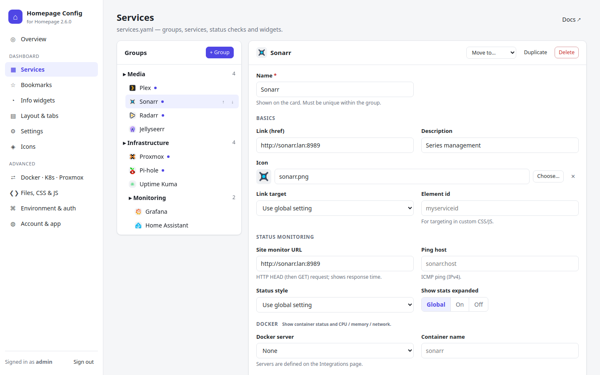
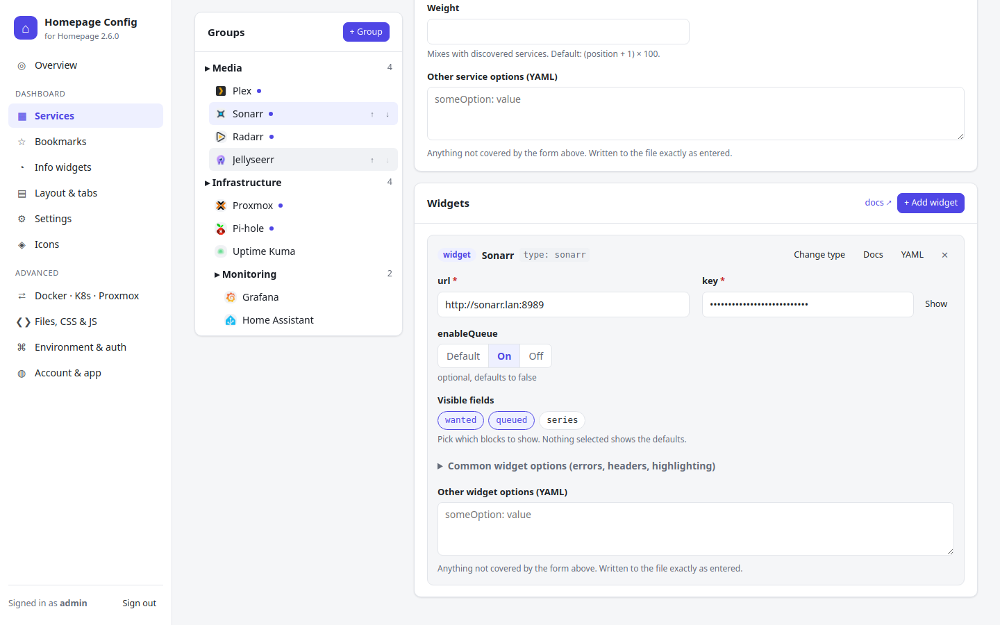
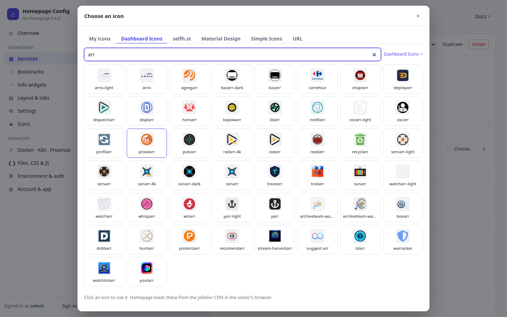
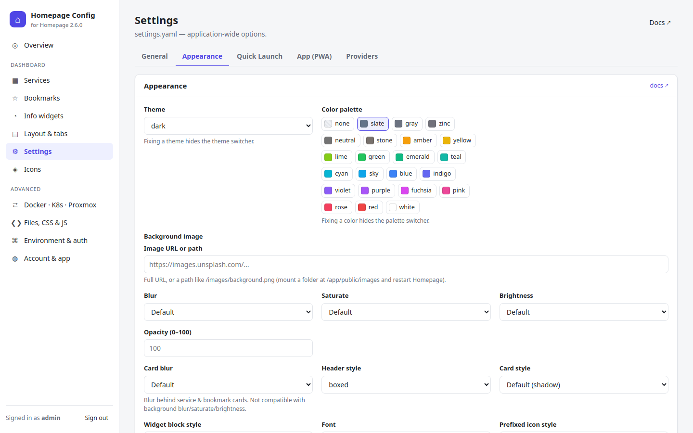

# Homepage Config

[](https://github.com/ckegels/homepage-config/actions/workflows/ci.yml)
[](https://github.com/ckegels/homepage-config/releases)
[](LICENSE)

A secure web UI for configuring [Homepage](https://github.com/gethomepage/homepage) (gethomepage.dev). Edit everything in forms instead of YAML files, including icon uploads.



## Features

- **Every option from the Homepage docs:** settings, services, bookmarks, info widgets, layout & tabs, Docker, Kubernetes and Proxmox.
- **All 160+ service widgets**, each with its own form and the docs shown inline.
- **Icons:** upload them, or pick from Dashboard Icons, selfh.st, Material Design and Simple Icons.
- **Safe editing:** validation, a raw file editor that keeps comments, and automatic backups with one-click restore.
- **Secure login:** setup token, optional 2FA, brute-force lockout. Runs unprivileged.
- **On an LXC:** edit Homepage's `.env` and restart Homepage from the browser.

| Service widgets | Icon picker | Settings |
| :---: | :---: | :---: |
| [](docs/images/widget.png) | [](docs/images/icons.png) | [](docs/images/settings.png) |

## Install

| Homepage runs… | Guide |
| -------------- | ----- |
| On a **Proxmox LXC** / Linux with systemd, without Docker | **[Install on LXC](docs/install-lxc.md)** |
| In **Docker** | [Install with Docker](docs/install-docker.md) |
| Anywhere else | [Manual install](docs/install-manual.md) |

**LXC quick start** (Homepage from the Proxmox community script):

```bash
apt update && apt install -y git
git clone https://github.com/ckegels/homepage-config.git /root/homepage-config
cd /root/homepage-config && ./scripts/install-lxc.sh
```

Then open `http://<lxc-ip>:3100`, enter the setup token the installer printed, and create your account.

## Documentation

- [Configuration & usage](docs/configuration.md): first sign-in, linking from Homepage, HTTPS, icons, backups, settings
- [Troubleshooting](docs/troubleshooting.md)
- [HANDOVER.md](HANDOVER.md): architecture, how everything works, progress log

## Development

```bash
npm install
npm run dev    # http://localhost:3100 with ./dev/config
npm test
```

There's no build step. To release, push a tag `vX.Y.Z`, and CI publishes `ghcr.io/ckegels/homepage-config`. To refresh the widget catalog after a Homepage release, run `npm run build:catalog -- <path-to-homepage-checkout>`.

## License

[GPL-3.0](LICENSE), the same as Homepage. This is an independent project, not affiliated with Homepage. `data/widget-catalog.json` is generated from the [Homepage docs](https://github.com/gethomepage/homepage/tree/main/docs) (© Homepage contributors, GPL-3.0).
